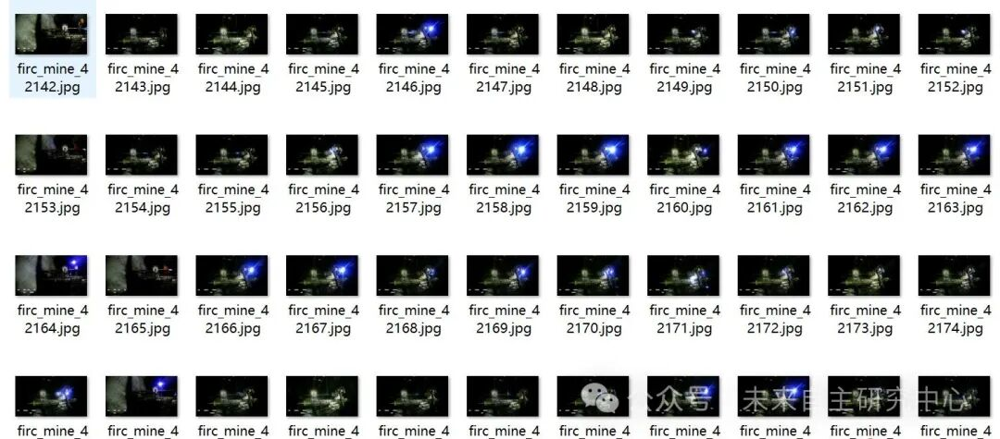
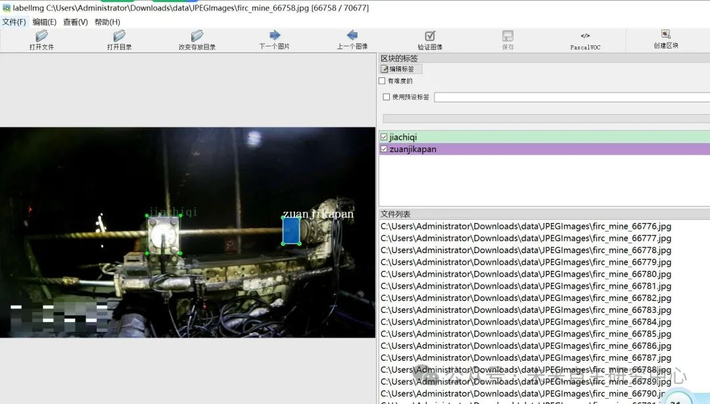
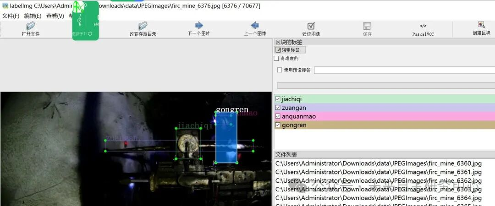

# Coal Mine Underground Drilling Platform Drill Chuck Safety Helmet Detection Data Set VOC+YOLO format with 70677 images in 5 categories

Dataset format: Pascal VOC format + YOLO format (txt file without split path, only containing jpg images and corresponding VOC format xml files and yolo format txt files)

Number of images (number of jpg files): 70677

Number of annotations (number of xml files): 70677

Number of annotations (number of txt files): 70677

Label category count: 5

Image resolution: 1280x720

Compressed Package Size: 2.72GB

Annotation category names: ["anquanmao", "gongren", "jiachiqi", "zuangan", "zuanjikapan"] => [Safety helmet, Coal Mining worker, Clamp, Drill rod, Drilling jack chuck]

Number of boxes labeled in each category:

anquanmao frame count = 31118

Gongren frame count = 39479

Jiachiqi Frames = 70248

Zuangan frame count = 67278

zuanjikapan frame count = 54205

Total frames: 262328

Using labelImg:

Annotation rules: Draw a rectangle around the category.

Important Notice: No

Special : This dataset does not guarantee the accuracy or precision of the trained models or weight files. The dataset is provided with accurate and reasonable annotations only.

Image

Image Preview:

Annotation example:

## Payment

Here is a pay link on Stripe ( https://buy.stripe.com/3cs8yP7sY87d0vu9AB ). Please contact me lonlonago@foxmail.com after funding $89, and I will send you a complete data files , thank you!

